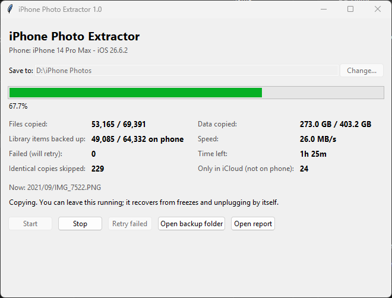

# iPhone Photo Extractor

Copy an entire iPhone photo and video library to a Windows PC over USB — reliably, even when the library
is huge — and then, optionally, clear it out of iCloud.

Built after Windows' own import (File Explorer / Photos app) kept freezing on a 64,000-item, 400 GB
library. Tested end to end on an iPhone 14 Pro Max running iOS 26: 69,391 files, 0 failures.



## What's in here

| Tool | What it does | Touches your data? |
|---|---|---|
| **Probe** (`Run Probe.bat`) | Checks your phone and PC before anything else: driver, connection, how many photos are on the phone, how many exist only in iCloud, real transfer speed, free disk space. | Read-only |
| **Photo Extractor** (`Run Photo Extractor.bat`) | Copies every photo and video to your PC in original quality, with a progress window. Resumes after freezes, crashes and unplugging. | Read-only on the phone |
| **iCloud Cleaner** (`Run iCloud Cleaner.bat`) | Deletes photos from iCloud — **only ones the extractor has verified on your PC** — in paced batches. A second mode permanently empties Recently Deleted. | **Deletes from iCloud** |
| **Network Watch** (`Run Network Watch.bat`) | Shows live, over USB, which apps on the iPhone are sending data and to which servers. | Read-only |

## Requirements

- Windows 10 or 11 (the launchers are `.bat` files; the Python code itself is cross-platform)
- **Apple Devices** from the Microsoft Store (or iTunes) — provides the Apple Mobile Device Service USB driver
- Python 3.10+ for Windows (the launchers offer to install it with `winget` if it's missing)
- A USB cable, and the iPhone unlocked and set to **Trust** this computer the first time

Everything else installs itself on first run into a private folder next to the scripts (`.venv`, and a
separate `.venv-icloud` for the iCloud tool, so the two never interfere).

## Quick start

1. Download or clone this repository into a normal Windows folder (not inside WSL — WSL can't see USB devices).
2. Plug in the iPhone, unlock it, double-click **Run Probe.bat**. Read the verdict at the end.
3. Double-click **Run Photo Extractor.bat**, check the **Save to** folder, press **Start**. Walk away.
4. When it finishes, read `_Export Reports\Export Report.txt` inside your backup folder.

If the probe says many items are "only in iCloud" (iCloud Photos with *Optimize iPhone Storage*), switch the
phone to **Settings › [your name] › iCloud › Photos › Download and Keep Originals**, leave it on Wi-Fi and
charging overnight, run the probe again, then run the extractor again — it only copies what's new.

## How the extractor stays reliable

- **Direct file access, not Windows' camera import.** It reads the phone's media files over Apple's AFC
  file service (via [pymobiledevice3](https://github.com/doronz88/pymobiledevice3)) instead of the
  WPD/PTP path that Explorer uses, which builds a full object list up front and may convert HEIC on the fly.
- **Batches, low memory.** Files are listed folder by folder into SQLite and copied in 1 MB chunks.
  Memory stays flat regardless of library size.
- **Freeze detection, two layers.** Every phone operation has a 30-second timeout. The copy engine runs as a
  separate process with a once-per-second heartbeat; if the heartbeat stops for 90 seconds the window
  kills and restarts it.
- **Never loses progress.** A file is marked done in the ledger (`.extractor\transfer.db` inside the backup
  folder) only after it's fully written, flushed to disk, verified and renamed into place. A crash at any
  point costs at most one partly copied file.
- **Verification.** Byte count must match the phone's reported size, the phone's copy must not have changed
  during the read, and the file's internal structure must be complete (JPEG end marker, PNG end chunk,
  full MP4/MOV/HEIC box chain, video index present). Files are judged by their contents, not their names.
- **No duplicates, no overwrites.** Files are identified by phone path + size, fingerprinted with SHA-256,
  and identical content is stored once. An existing file on the PC is never overwritten — name clashes
  get a ` (2)` suffix.
- **Metadata kept.** Files are copied byte-for-byte (EXIF, GPS and video metadata intact), saved under their
  original filenames (from the phone's Photos database, which also restores names for iCloud-synced items
  stored under codes), sorted into `Year\Month` folders, with Windows created/modified dates set to the
  capture time. Live Photo halves and edit sidecars (`.AAE`) sit next to their photo.
- **The phone is never modified.** All phone access goes through one read-only class: list, get info, open
  for reading, read, close. There is no write, rename or delete code for the phone.

Speed is limited by the phone's port: Lightning iPhones run at USB 2.0 speeds (~33 MB/s measured, about
2 hours per 250 GB). The PC is kept awake during a run.

## iCloud Cleaner — read this before using it

The cleaner uses [pyicloud](https://github.com/timlaing/pyicloud), which talks to iCloud the same way
icloud.com does. It is **not** an official Apple API.

Safeguards:
- **Only deletes what's backed up.** Every iCloud item must match a verified file in the extractor's ledger
  (original name + size, or name + date taken) and that file must still exist on disk. Unmatched items are
  kept and listed in a CSV.
- **One-photo test first,** then it waits for you to confirm before doing the rest.
- **Sign in once.** Password is never stored; the trusted session is saved on the PC and reused. A rejected
  password is never retried automatically.
- **Paced** at 200 items per request with pauses; backs off if Apple asks it to slow down and stops if the
  session is rejected. Progress is saved — run it again to continue.

Mode 1 moves photos to **Recently Deleted** (30-day undo, same as deleting on icloud.com). Mode 2 marks
backed-up items in Recently Deleted as expunged, which is **permanent** — after that your PC backup is the
only copy. Make a second copy of the backup first if you can.

Note: if iCloud Photos is on, deleting in iCloud also deletes from the phone. Photos that were never
uploaded to iCloud (for example, taken after your iCloud storage filled up) stay on the phone and need to
be removed on the phone itself.

## Tests

The test suite runs against simulated phones and a simulated iCloud — no device or account needed:

```
pip install -r requirements-dev.txt
python tests/test_engine.py       # indexing, stalls, resume, duplicates, crash recovery, no-overwrite, locking
python tests/test_supervisor.py   # freeze detection and automatic restart
python tests/test_cleaner.py      # matching, test delete, rate limiting, per-item errors, resume
python tests/test_trash.py        # Recently Deleted mode
python tests/test_probe.py
python tests/test_netwatch.py     # packet parsing (needs scapy)
```

## Limitations

- Shared Albums and items stored only in iCloud can't be read over USB; the probe and the report list them.
- Edited versions are not exported separately (the original plus its `.AAE` edit file are).
- Windows-only launchers; on macOS/Linux you can run the Python files directly with the requirements installed.

## License and disclaimer

GPL-3.0-or-later (see `LICENSE`), because the extractor builds on pymobiledevice3, which is GPL-3.0.

Not affiliated with or endorsed by Apple. iPhone and iCloud are trademarks of Apple Inc. Use at your own
risk — especially the iCloud Cleaner, which deletes data.
